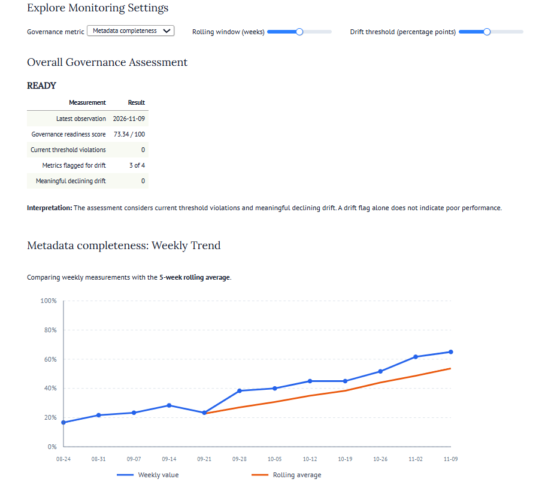

# cintel-06-continuous-intelligence-sowers

[](pyproject.toml)
[](https://github.com/ssowers2/cintel-06-continuous-intelligence-sowers/actions/workflows/ci-python-zensical.yml)
[](https://ssowers2.github.io/cintel-06-continuous-intelligence-sowers/)
[](https://docs.astral.sh/uv/)
[](https://docs.astral.sh/ty/)
[](https://zensical.org/)
[](LICENSE)

> Integrate anomaly detection, signal design, rolling monitoring, and drift detection to assess system performance and healthcare data governance readiness.

## Project Overview

**Author:** Sabriya Sowers

**Date:** November 2026

This project brings together techniques introduced throughout the Continuous Intelligence course, including signal design, anomaly detection, rolling monitoring, and drift detection.

The original example uses operational system measurements to identify unusual behavior and classify the overall system state as STABLE or DEGRADED.

### Custom Governance Application

The Metadata Completeness & Governance Readiness Monitor extends previous Continuous Intelligence projects into one integrated monitoring system.

The custom application combines a Python governance intelligence pipeline with an interactive Marimo dashboard.

The goal is to evaluate synthetic healthcare metadata, identify potential governance concerns, monitor trends, detect meaningful changes, and generate an overall readiness assessment.

Four governance metrics are monitored:

- Metadata completeness
- Ownership coverage
- Stewardship coverage
- Documentation gaps

The application uses synthetic data for educational purposes and does not represent actual healthcare organization performance.

The project is configured in [pyproject.toml](pyproject.toml).

## Data

### Original Example Dataset

The instructor example uses system metrics from `data/system_metrics.csv`.

Each observation includes:

- `requests` - number of requests handled.
- `errors` - number of failed requests.
- `total_latency_ms` - total response time in milliseconds.

The example contains 60 observations and demonstrates an integrated monitoring assessment.

### Governance Dataset

The custom application uses synthetic healthcare metadata developed in previous projects.

| Dataset | Description |
|---|---|
| `metadata_inventory.csv` | Original inventory of 60 synthetic metadata assets |
| `governance_inventory_timeseries.csv` | 720 simulated asset-week observations |
| `governance_metrics_timeseries.csv` | 12 weekly governance summaries |

The weekly dataset provides the four governance metrics used in the integrated monitoring pipeline and interactive dashboard.

## Approach

### Original System Assessment

The original pipeline uses Polars to:

1. Read system measurements.
2. Calculate error rate and average latency.
3. Identify signals exceeding defined thresholds.
4. Summarize system behavior.
5. Assign a system assessment based on the monitored signals.

### Integrated Governance Intelligence

The custom pipeline applies five continuous intelligence techniques:

1. **Signal design:** Calculate a composite governance readiness score.
2. **Anomaly detection:** Identify metrics outside configured governance thresholds.
3. **Rolling monitoring:** Calculate moving averages to evaluate trends.
4. **Drift detection:** Compare reference and current observation periods.
5. **Governance assessment:** Combine current anomalies and declining drift into an overall readiness classification.

Explore these project components:

- [pyproject.toml](pyproject.toml) - project configuration and dependencies.
- [src/cintel/continuous_intelligence.py](src/cintel/continuous_intelligence.py) - original integrated monitoring pipeline.
- [src/cintel/governance_intelligence.py](src/cintel/governance_intelligence.py) - custom governance intelligence pipeline.
- [src/cintel/utils_governance.py](src/cintel/utils_governance.py) - governance monitoring functions.
- [src/cintel/governance_app.py](src/cintel/governance_app.py) - interactive governance dashboard.
- [data/](data/) - system and synthetic governance datasets.
- [artifacts/](artifacts/) - generated assessment results.
- [tests/](tests/) - automated tests.
- [.github/workflows/](.github/workflows/) - automated checks and documentation deployment.
- [docs/](docs/) - project documentation.

## Run the Project

Follow the [Professional Python Workflow Guide](https://denisecase.github.io/pro-analytics-02/) to set up the project environment.

From a VS Code terminal in the project root:

```powershell
uv run python -m cintel.continuous_intelligence
```

This executes the original system assessment pipeline.

## Run the Original Reactive App

From the project root:

```powershell
uv run marimo run src/cintel/app.py
```

Press `Ctrl + C` in the terminal to stop the application.

## Original System Assessment Results

The pipeline summarizes monitored signals and writes:

`artifacts/system_assessment.csv`

The original example uses a 40 ms latency threshold and classifies the overall system state as STABLE.

The modified experiment uses a 30 ms threshold and produces a DEGRADED classification.

- **STABLE:** Summary signals remain within the defined thresholds.
- **DEGRADED:** One or more summary signals exceed the defined thresholds.

Successful execution produces a terminal message:

```text
========================
Pipeline executed successfully!
========================
```

A `project.log` file is created in the project root.

This confirms that the Python pipeline executes and the logging system works.

## Technical Experiment: Adjusting the Latency Threshold

A controlled experiment evaluated how changing a monitoring threshold affects the overall system assessment.

### Modification

Changed `MAX_AVG_LATENCY` in `src/cintel/continuous_intelligence.py` from 40.0 to 30.0 milliseconds.

The underlying system measurements remained unchanged.

### Prediction

The system classification was expected to change from STABLE to DEGRADED because the average latency of 33.71 milliseconds exceeds the modified threshold of 30 milliseconds.

### Results

The pipeline executed successfully and confirmed the predicted change.

| Measurement | Original | Modified |
|---|---|---|
| Latency threshold | 40 ms | 30 ms |
| Average latency | 33.71 ms | 33.71 ms |
| System state | STABLE | DEGRADED |

At this stage of development, automated testing completed successfully with one passing test and 44.17% code coverage.

### Interpretation

The experiment demonstrates how monitoring thresholds influence system classifications without changing the underlying data.

Selecting appropriate thresholds is important for producing meaningful assessments and avoiding unnecessary alerts.

The full experiment, including methodology and interpretation, is documented on the [Project 06 Documentation Site](https://ssowers2.github.io/cintel-06-continuous-intelligence-sowers/).

[View Modified System Assessment](artifacts/system_assessment.csv)

---

## Integrated Governance Monitoring

The custom application applies continuous intelligence techniques to 12 weeks of synthetic healthcare metadata measurements.

### Techniques Applied

- **Signal design:** Calculates a composite governance readiness score using four equally weighted metrics.
- **Anomaly detection:** Identifies measurements that fall outside illustrative governance thresholds.
- **Rolling monitoring:** Calculates five-week rolling averages to identify trends.
- **Drift detection:** Compares six historical weeks with six current weeks using a 20-percentage-point threshold.
- **Governance assessment:** Combines current anomalies and declining drift to classify governance readiness.

### Governance Thresholds

| Metric | Threshold | Anomaly Condition |
|---|---:|---|
| Metadata completeness | 60% | Below threshold |
| Ownership coverage | 75% | Below threshold |
| Stewardship coverage | 70% | Below threshold |
| Documentation gaps | 35% | Above threshold |

These thresholds are illustrative and have not been validated as organizational standards.

### Run the Governance Pipeline

From the project root in VS Code:

```powershell
uv run python -m cintel.governance_intelligence
```

The pipeline generates three CSV artifacts:

- `artifacts/governance_integrated_weekly.csv`
- `artifacts/governance_integrated_drift.csv`
- `artifacts/governance_integrated_assessment.csv`

### Verified Results

| Measurement | Result |
|---|---|
| Weekly observations | 12 |
| Latest observation | November 9, 2026 |
| Governance readiness score | 73.34 |
| Current threshold violations | 0 |
| Metrics flagged for drift | 3 of 4 |
| Declining drift | 0 |
| Overall governance state | READY |

Three governance metrics exceeded the drift threshold, but all four metrics improved between the reference and current periods.

The overall classification is READY because the latest measurements have no threshold violations and no meaningful declining drift.

These classifications and thresholds are illustrative and are not established healthcare governance standards.

### Interpretation

The integrated monitoring system demonstrates that governance readiness should be evaluated using multiple signals rather than relying on individual metrics.

The results also distinguish meaningful drift from unfavorable performance.

Although three metrics showed meaningful changes, those changes represented improvements rather than declining governance performance.

---

## Interactive Governance Dashboard

An interactive Marimo dashboard was developed to provide a visual interface for the integrated governance intelligence pipeline.

The dashboard combines monitoring results, trend analysis, drift detection, and governance readiness assessment.

### Governance Monitoring Visualization



*Metadata completeness over 12 weekly observations, showing weekly measurements and a five-week rolling average.*

### Dashboard Features

- Displays the overall governance readiness classification and composite score.
- Supports selection of four governance metrics.
- Visualizes weekly observations and rolling averages.
- Provides an adjustable rolling monitoring window from 2 to 8 weeks.
- Provides an adjustable drift threshold from 5 to 40 percentage points.
- Displays reference-period and current-period drift comparisons.
- Includes weekly monitoring details and anomaly results.


### How to Launch the Dashboard

There are two ways to access the interactive governance dashboard.

#### Option 1: Launch the Published Dashboard (Recommended)

Open the dashboard directly in a web browser:

**[Launch Interactive Governance Dashboard](https://ssowers2.github.io/cintel-06-continuous-intelligence-sowers/governance/)**

No Python installation, local environment, or terminal commands are required.

#### Option 2: Run the Dashboard Locally

To run the original interactive Marimo application:

1. Clone or download the repository.
2. Open the project folder in VS Code.
3. Set up the Python environment using `uv sync`.
4. Open a terminal in the project root.
5. Run:

```powershell
uv run marimo run src/cintel/governance_app.py
```

Marimo provides a local URL for opening the dashboard in a browser.

Press `Ctrl + C` in the terminal to stop the application.

### Export and Preview the Dashboard Locally

To build and preview the browser-based WebAssembly version, run the following commands from the project root:

```powershell
uv run python -m zensical build
uv run marimo export html-wasm src/cintel/governance_app.py -o site/governance --mode run --force
uv run python -m http.server 8000 --bind 127.0.0.1 --directory site
```

Then open:

- Documentation: http://localhost:8000/
- Interactive Dashboard: http://localhost:8000/governance/

Keep the terminal running while viewing the local website. Press `Ctrl + C` to stop the server.

**Note:** Build the Zensical documentation before exporting Marimo because rebuilding the documentation may replace the generated `site/` directory.

### Deployment

GitHub Actions automatically builds the Zensical documentation, exports the Marimo WebAssembly dashboard, and deploys both to GitHub Pages when changes are pushed to `main`.

The published dashboard does not require a local Python installation.

---

## Automated Testing

Run:

```powershell
uv run pytest -v
```

Automated testing completed successfully with **7 passing tests and 37.11% overall code coverage**, exceeding the required 20% threshold.

The interactive Marimo dashboard was also verified manually in both the local development environment and the browser-based WebAssembly export.

Additional project quality checks include:

```powershell
uv run ruff check .
uv run ty check
```

See the [Project Documentation](https://ssowers2.github.io/cintel-06-continuous-intelligence-sowers/) for detailed analysis and interpretation.

## Verification

The project includes verification of:

- Original system assessment execution.
- Modified latency threshold experiment.
- Integrated governance pipeline execution.
- Governance assessment artifacts.
- Automated unit tests.
- Ruff linting and ty type checking.
- Interactive Marimo dashboard functionality.
- Browser-based WebAssembly export.
- Local Zensical documentation build.

## Project Documentation

The [hosted documentation site](https://ssowers2.github.io/cintel-06-continuous-intelligence-sowers/) is published using Zensical and GitHub Pages.

The documentation presents the project report, including data, methods, results, visualizations, interpretation, and conclusions.

The interactive governance dashboard is configured to be published as part of the same website.

## CI/CD and GitHub Actions

This project includes continuous integration and continuous deployment (CI/CD) to check project files and publish documentation.

GitHub Actions include:

- [CI: Python and Documentation Checks](https://github.com/ssowers2/cintel-06-continuous-intelligence-sowers/actions/workflows/ci-python-zensical.yml)
- [CD: Documentation Deployment](https://github.com/ssowers2/cintel-06-continuous-intelligence-sowers/actions/workflows/deploy-zensical.yml)

The documentation deployment workflow builds the Zensical site and exports the Marimo governance dashboard into the website's `site/governance/` directory.

The combined site is then uploaded and deployed through GitHub Pages.

---

## Developer Reference

Follow the [Professional Python Workflow Guide](https://denisecase.github.io/pro-analytics-02/) for detailed instructions and troubleshooting.

### Initialize and Update the Python Environment

With the project open in VS Code, open a terminal.

Run each command as needed:

```powershell
uvx pup-clean --delete
uv self update
uv python pin 3.14
uv python install
uv lock --upgrade
uv sync
uv audit
```

### Set Up and Run Git Hooks

Set up and run Git hooks to perform basic checks automatically before changes are pushed to GitHub.

```powershell
uvx prek install --force
uvx prek update --freeze --cooldown-days 7

git add -A
uvx prek run --all-files

# Repeat if changes were made.
uvx prek run --all-files
```

### Run Common Chores

Run linters, formatters, type checks, tests, and build the documentation.

```powershell
uv run ruff check . --fix
uv run ruff format .

uv run ty check
uv run python -m pytest
uv run python -m zensical build
```

### Git Add, Commit, and Push to GitHub

After making useful changes, save the work to GitHub.

```powershell
git add -A
git commit -m "describe your changes in quotes"
git push -u origin main
```

## Developer Notes

- Use the **UP ARROW** and **DOWN ARROW** in the terminal to scroll through previous commands.
- Use `Ctrl + F` to find text within a file.

## Developer Tools

This project uses professional Python tools to support development, testing, documentation, and code quality.

- [uv](https://docs.astral.sh/uv/) - Python environments and dependencies.
- [Ruff](https://docs.astral.sh/ruff/) - Python linting and formatting, configured in [.ruff.toml](.ruff.toml).
- [ty](https://docs.astral.sh/ty/) - Python type checking.
- [pytest](https://docs.pytest.org/) - automated Python testing, configured in [.pytest.toml](.pytest.toml).
- [prek](https://prek.j178.dev/) - Git hooks and automated checks, configured in [prek.toml](prek.toml).
- [Zensical](https://zensical.org/) - project documentation, configured in [zensical.toml](zensical.toml).
- [Marimo](https://marimo.io/) - interactive Python dashboards and WebAssembly export.

## Links

- [GitHub Repository](https://github.com/ssowers2/cintel-06-continuous-intelligence-sowers)
- [Hosted Documentation](https://ssowers2.github.io/cintel-06-continuous-intelligence-sowers/)
- [Interactive Governance Dashboard](https://ssowers2.github.io/cintel-06-continuous-intelligence-sowers/governance/)
- [Professional Python Workflow Guide](https://denisecase.github.io/pro-analytics-02/)
- [Citation](CITATION.cff)
- [License](LICENSE)
