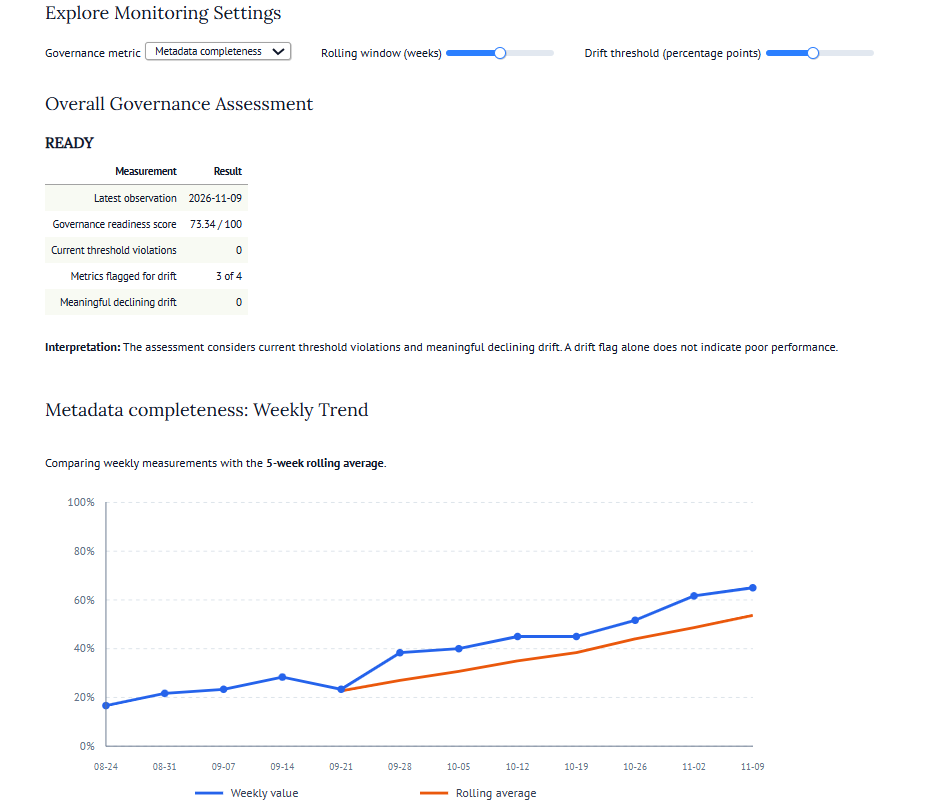

# Continuous Intelligence Portfolio

## Sabriya Sowers

November 2026

This portfolio highlights the continuous intelligence techniques developed throughout the course, with a focus on healthcare data quality, metadata governance, and system monitoring.

Each project builds on previously introduced concepts, progressing from basic data validation to an integrated governance readiness monitoring application.

## 1. Professional Project

### Repository Link

[Project 01 — Getting Started](https://github.com/ssowers2/cintel-01-getting-started-sowers)

### Brief Overview of Project Tools and Choices

Established a professional Python development environment using VS Code, uv, Git, GitHub, and automated testing tools.

The initial customization used fictional healthcare department records to identify missing values and visualize the results using Matplotlib.

The pipeline identified three missing values across five records, demonstrating how Python can support basic data quality monitoring.

This project established the technical foundation for the remaining Continuous Intelligence applications.

## 2. Anomaly Detection

### Repository Link

[Project 02 — Static Anomalies](https://github.com/ssowers2/cintel-02-static-anomalies-sowers)

### Techniques

Applied threshold-based anomaly detection and data quality validation using Python and Polars.

The custom application evaluated 50 synthetic pediatric records for missing ages, missing heights, negative values, and zero heights.

An interactive Plotly dashboard visualized the results.

### Artifacts

[View Project 02 Artifacts](https://github.com/ssowers2/cintel-02-static-anomalies-sowers/tree/main/artifacts)

The `pediatric_quality_issues.csv` file contains records flagged by the validation rules.

### Insights

Thirteen of the 50 synthetic records were flagged for data quality issues, while 37 passed the defined checks.

Missing age was the most common issue. The analysis demonstrated the importance of validating completeness and basic data integrity before using information for reporting or analysis.

## 3. Signal Design

### Repository Link

[Project 03 — Signal Design](https://github.com/ssowers2/cintel-03-signal-design-sowers)

### Signals

Developed a Metadata Completeness & Governance Readiness Monitor using 60 synthetic healthcare metadata assets across five departments.

Four governance signals were calculated:

- Metadata completeness
- Ownership coverage
- Stewardship coverage
- Documentation gaps

A governance readiness heatmap was created to compare departmental results.

### Artifacts

[View Project 03 Artifacts](https://github.com/ssowers2/cintel-03-signal-design-sowers/tree/main/artifacts)

Generated files include asset-level governance signals, departmental summaries, and a governance readiness heatmap.

### Insights

Ownership coverage reached 91.67%, while stewardship coverage was 70.00%, and documentation gaps affected 33.33% of assets.

The results indicated that stewardship assignments and documentation completeness presented greater improvement opportunities than ownership assignments within the synthetic dataset.

This project established the governance metrics used in subsequent modules.

## 4. Rolling Monitoring

### Repository Link

[Project 04 — Rolling Monitoring](https://github.com/ssowers2/cintel-04-rolling-monitoring)

### Techniques

Extended the Project 03 metadata inventory into 12 simulated weekly observations.

Applied five-week rolling averages to metadata completeness, ownership coverage, stewardship coverage, and documentation gaps.

An interactive Marimo dashboard allowed exploration of individual metrics and changes in rolling-window size.

### Artifacts

[View Project 04 Artifacts](https://github.com/ssowers2/cintel-04-rolling-monitoring/tree/main/artifacts)

The `governance_rolling_metrics.csv` file contains weekly governance measurements and calculated rolling averages.

### Insights

Metadata completeness generally improved across the simulated observation period, although individual weekly values fluctuated.

The rolling averages made broader trends easier to identify while reducing the influence of short-term variation.

The analysis also demonstrated the tradeoff between smaller, more responsive windows and larger, smoother windows.

## 5. Drift Detection

### Repository Link

[Project 05 — Drift Detection](https://github.com/ssowers2/cintel-05-drift-detection)

### Techniques

Compared the first six weeks of simulated governance measurements with the most recent six weeks.

Calculated differences between reference and current averages and applied an illustrative drift threshold of 20 percentage points.

An interactive Marimo dashboard supported adjusting the drift threshold and examining the results through Plotly visualizations.

### Artifacts

[View Project 05 Artifacts](https://github.com/ssowers2/cintel-05-drift-detection/tree/main/artifacts)

The `governance_drift_summary.csv` file records metric comparisons and drift flags. A separate chart visualizes governance changes.

### Insights

Three of the four governance metrics exceeded the drift threshold:

| Governance Metric | Change | Drift Detected |
|---|---:|---|
| Metadata completeness | +26.11 pp | Yes |
| Ownership coverage | +22.50 pp | Yes |
| Stewardship coverage | +16.11 pp | No |
| Documentation gaps | -22.22 pp | Yes |

All four metrics moved in favorable directions.

The most important finding was that significant drift does not necessarily indicate declining performance. Understanding the direction and operational meaning of changes is essential to interpreting monitoring results.

## 6. Continuous Intelligence Pipeline

### Repository Link

[Project 06 — Continuous Intelligence](https://github.com/ssowers2/cintel-06-continuous-intelligence-sowers)

### Techniques

Integrated signal design, anomaly detection, rolling monitoring, drift detection, and system assessment into one healthcare metadata governance monitoring application.

The pipeline analyzes 12 weekly governance observations developed from 60 synthetic metadata assets.

The application includes:

- A composite governance readiness score.
- Threshold-based anomaly detection.
- Adjustable rolling monitoring windows.
- Reference and current-period drift comparisons.
- Directional drift interpretation.
- Overall governance readiness classifications.

An interactive Marimo dashboard allows users to explore monitoring results and adjust analytical controls directly in a browser.

### Artifacts

[View Project 06 Artifacts](https://github.com/ssowers2/cintel-06-continuous-intelligence-sowers/tree/main/artifacts)

The integrated pipeline generates:

- `governance_integrated_weekly.csv` — Weekly measurements and monitoring signals.
- `governance_integrated_drift.csv` — Drift comparisons and classifications.
- `governance_integrated_assessment.csv` — Overall governance readiness assessment.

### Governance Monitoring Visualization

*Weekly metadata completeness measurements compared with a five-week rolling average.*

### Interactive Dashboard

**[Launch the Interactive Governance Dashboard](https://ssowers2.github.io/cintel-06-continuous-intelligence-sowers/governance/)**

The application runs in a browser using Marimo and WebAssembly.

### Assessment

| Measurement | Result |
|---|---|
| Governance readiness score | 73.34 |
| Current threshold violations | 0 |
| Metrics flagged for drift | 3 of 4 |
| Declining drift | 0 |
| Overall governance state | READY |

The integrated pipeline classified governance readiness as **READY**, with no current threshold violations or meaningful declining drift.

Although three governance metrics exceeded the drift threshold, those changes represented improvements.

The final project demonstrated how individual monitoring techniques can be combined to produce a broader and more meaningful assessment of governance readiness.

## Final Reflection

These projects demonstrated that effective monitoring extends beyond calculating metrics or identifying unusual values.

Meaningful continuous intelligence requires reliable data, interpretable signals, appropriate thresholds, historical comparisons, and domain knowledge to determine whether changes require action.

The most rewarding accomplishment was developing a connected series of healthcare data governance applications and bringing those techniques together into an interactive, publicly accessible monitoring dashboard.

**Note:** All healthcare and governance data used in these projects is synthetic. Monitoring thresholds and readiness classifications are illustrative and are not validated organizational or clinical standards.
