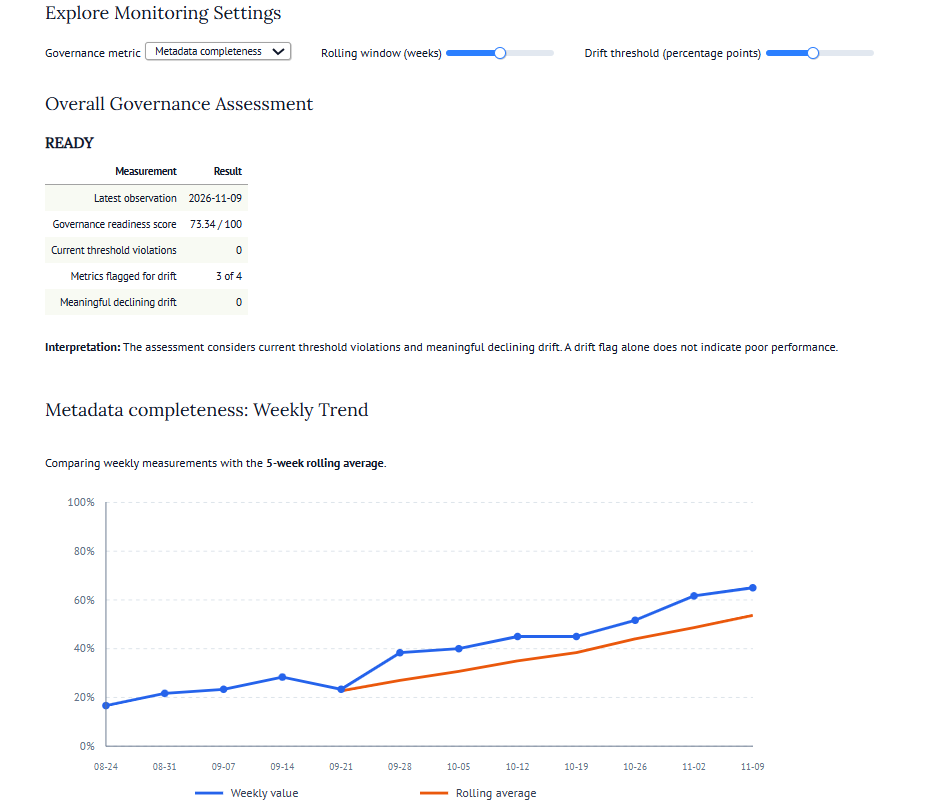

# Continuous Intelligence System Assessment

Continuous Intelligence | Project 06 | Example Report

## Overview

This project integrates signal design, anomaly detection, and system assessment into a continuous intelligence pipeline.

The objective is to transform operational measurements into interpretable indicators of system behavior and produce an overall assessment of system state.

## Data

The example dataset contains 60 observations of system activity.

Each observation records:

- Requests handled.
- Errors encountered.
- Total response time in milliseconds.

The dataset includes a period of elevated errors and response times.

[View Example Dataset](https://github.com/ssowers2/cintel-06-continuous-intelligence-sowers/blob/main/data/system_metrics.csv)

## Methods

The pipeline applies three analytical steps.

### 1. Signal Design

Raw measurements are transformed into:

- Error rate: errors divided by requests.
- Average latency: total latency divided by requests.

### 2. Anomaly Detection

Individual observations are flagged when:

- Error rate exceeds 5%, or
- Average latency exceeds 40 milliseconds.

### 3. System Assessment

The pipeline calculates mean values across all observations.

It classifies the overall system state as:

- `STABLE` when neither mean signal exceeds its threshold.
- `DEGRADED` when either mean signal exceeds its threshold.

## Results

The original example, using a 40 ms latency threshold, produces the following assessment.

| Metric | Result |
|---|---:|
| Average requests | 157.35 |
| Average errors | 4.43 |
| Average error rate | 2.65% |
| Average latency | 33.71 ms |
| Overall system state | STABLE |

The original example also identifies **7 anomalous observations** using its original thresholds.

[View Modified System Assessment](https://github.com/ssowers2/cintel-06-continuous-intelligence-sowers/blob/main/artifacts/system_assessment.csv)

## Technical Experiment: Adjusting the Latency Threshold

### Modification

Changed `MAX_AVG_LATENCY` in `src/cintel/continuous_intelligence.py` from 40.0 to 30.0 milliseconds.

### Purpose

Evaluate how adjusting a monitoring threshold affects the overall system assessment without changing the underlying data.

### Prediction

The system classification was expected to change from STABLE to DEGRADED because the average latency of 33.71 milliseconds exceeds the new threshold of 30 milliseconds.

### Results

The pipeline executed successfully, and the system assessment changed from STABLE to DEGRADED.

| Measurement | Original | Modified |
|---|---|---|
| Latency threshold | 40 ms | 30 ms |
| Average latency | 33.71 ms | 33.71 ms |
| System state | STABLE | DEGRADED |

Automated testing completed successfully with one passing test and 44.17% code coverage at this stage of development.

### Interpretation

The experiment demonstrates that monitoring thresholds directly influence system classifications. The underlying system measurements remained unchanged, but lowering the latency threshold caused the system to be classified as DEGRADED. This highlights the importance of selecting thresholds based on operational expectations and meaningful performance requirements.

## Original Interpretation

The overall assessment is `STABLE` because the average error rate and latency remain below their configured thresholds.

However, several individual observations exceed the anomaly thresholds.

This distinction is important.

A system may appear stable when summarized across an entire observation period while experiencing shorter episodes of degraded performance.

Monitoring should consider both overall conditions and localized anomalies.

## Limitations

The original example assessment is based on aggregate means and fixed thresholds.

It does not yet incorporate rolling-window analysis, reference-period drift comparisons, or persistent alerting.

The final assessment artifact contains summary metrics but does not preserve the individual anomaly records.

A more complete system could retain observation-level evidence and combine rolling monitoring, drift detection, and system-state classification.

## Conclusion

Continuous intelligence connects measurements, signals, analytical rules, and interpretation.

The original example demonstrates how several techniques can contribute to an assessment of system behavior.

Its most important finding is that **an overall stable classification does not guarantee that every observation was within acceptable limits.**

Effective monitoring requires both summary assessments and sufficient detail to investigate anomalous conditions.

## Documentation Index

- **Home** - this landing page
- [**Project Instructions**](project-instructions.md)
- [**Glossary**](glossary.md)
- [**API**](api.md)

## Project Links

- [GitHub Repository](https://github.com/ssowers2/cintel-06-continuous-intelligence-sowers)
- [Example Pipeline](https://github.com/ssowers2/cintel-06-continuous-intelligence-sowers/blob/main/src/cintel/continuous_intelligence.py)
- [Results and Artifacts](https://github.com/ssowers2/cintel-06-continuous-intelligence-sowers/tree/main/artifacts)

## Project Resources

- [Project Instructions](project-instructions.md)
- [Professional Python Guide](https://denisecase.github.io/pro-analytics-02/)
- [Professional Python Project Explainer](https://pup-pack.github.io/professional-python-project-explainer/)
- [Suggested Datasets](https://denisecase.github.io/pro-analytics-02/reference/datasets/cintel/)

---

## Custom Application: Integrated Governance Intelligence

### Problem and Objective

The Metadata Completeness & Governance Readiness Monitor extends previous Continuous Intelligence projects into one integrated monitoring system.

The central question is:

> Can signal design, anomaly detection, rolling monitoring, and drift detection be combined to provide a meaningful assessment of healthcare metadata governance readiness?

The objective is to evaluate governance metrics together, identify potential concerns, and generate an overall readiness classification supported by monitoring evidence.

### Data

The analysis uses synthetic healthcare metadata developed in previous projects.

| Dataset | Description |
|---|---|
| `metadata_inventory.csv` | Original inventory of 60 synthetic metadata assets |
| `governance_inventory_timeseries.csv` | 720 simulated asset-week observations |
| `governance_metrics_timeseries.csv` | 12 weekly governance summaries |

Four metrics are monitored:

- Metadata completeness
- Ownership coverage
- Stewardship coverage
- Documentation gaps

All observations are synthetic and do not contain patient information or actual organizational performance data.

### Techniques Applied

#### 1. Signal Design

A composite governance readiness score is calculated by averaging metadata completeness, ownership coverage, stewardship coverage, and the inverse of documentation gaps.

Each component receives equal weight, and higher scores indicate greater readiness.

#### 2. Anomaly Detection

Weekly measurements are evaluated against illustrative readiness thresholds.

| Metric | Threshold | Anomaly condition |
|---|---:|---|
| Metadata completeness | 60% | Below threshold |
| Ownership coverage | 75% | Below threshold |
| Stewardship coverage | 70% | Below threshold |
| Documentation gaps | 35% | Above threshold |

#### 3. Rolling Monitoring

Five-week rolling averages are calculated for the four governance metrics to smooth short-term fluctuations and support trend analysis.

#### 4. Drift Detection

The first six observations are compared with the most recent six observations.

A 20-percentage-point threshold identifies meaningful changes. Drift direction is evaluated separately to distinguish improvement from decline.

#### 5. Governance Readiness Assessment

The integrated pipeline evaluates the latest threshold violations and meaningful declining drift.

- **READY:** No current threshold violations or declining flagged drift.
- **NEEDS ATTENTION:** One or two current threshold violations, or meaningful declining drift.
- **AT RISK:** Three or more current threshold violations.

These rules are illustrative and require stakeholder validation before operational use.

### Results

The integrated pipeline successfully processed 12 weekly observations and generated the following assessment.

| Measurement | Result |
|---|---:|
| Latest observation | November 9, 2026 |
| Governance readiness score | 73.34 |
| Current anomalies | 0 |
| Drift flags | 3 of 4 |
| Declining drift | 0 |
| Governance state | READY |

#### Drift Comparison

| Governance metric | Reference mean | Current mean | Change | Drift |
|---|---:|---:|---:|---|
| Metadata completeness | 25.28% | 51.39% | +26.11 pp | Yes |
| Ownership coverage | 65.28% | 87.78% | +22.50 pp | Yes |
| Stewardship coverage | 49.72% | 65.83% | +16.11 pp | No |
| Documentation gaps | 64.72% | 42.50% | -22.22 pp | Yes |

All four metrics moved in a favorable direction.

### Interpretation

The integrated assessment classified governance readiness as READY based on the latest observations and configured rules.

Although three metrics exceeded the drift threshold, their changes represented improvement rather than declining performance.

This demonstrates why meaningful change should be evaluated alongside direction, operational expectations, and business context.

### Interactive Governance Dashboard

An interactive Marimo dashboard extends the integrated governance intelligence pipeline with visual monitoring and adjustable analytical controls.

The dashboard allows users to:

- Review the overall governance readiness classification and composite score.
- Explore weekly trends across four governance metrics.
- Compare weekly measurements with rolling averages.
- Adjust the rolling monitoring window from 2 to 8 weeks.
- Adjust the drift detection threshold from 5 to 40 percentage points.
- Review drift results and weekly monitoring evidence.

The dashboard runs directly in a web browser using Marimo and WebAssembly (WASM), without requiring users to install Python.

#### Governance Monitoring Visualization

*Metadata completeness over 12 weekly observations, showing weekly measurements and a five-week rolling average.*

**[Launch the Interactive Governance Dashboard](./governance/)**

### Verification

The pipeline executed successfully and generated three evidence artifacts:

- `artifacts/governance_integrated_weekly.csv`
- `artifacts/governance_integrated_drift.csv`
- `artifacts/governance_integrated_assessment.csv`

Automated testing completed successfully with **7 passing tests and 37.11% overall code coverage**, exceeding the required 20% threshold.

The interactive Marimo dashboard was also verified manually in both the local development environment and the browser-based WebAssembly export.

The interactive dashboard was also tested successfully in the local Marimo environment and as an exported WebAssembly application served through a local web server.

### Limitations and Next Steps

The analysis uses synthetic data covering only 12 weeks. The readiness thresholds, composite score weights, and classification rules are illustrative rather than validated organizational standards.

The integrated pipeline and interactive Marimo dashboard have been developed and tested locally, including successful execution of the browser-based WebAssembly export.

Future improvements could include stakeholder-approved thresholds, actual governed metadata sources, longer observation periods, automated notifications, and persistent alerting.
